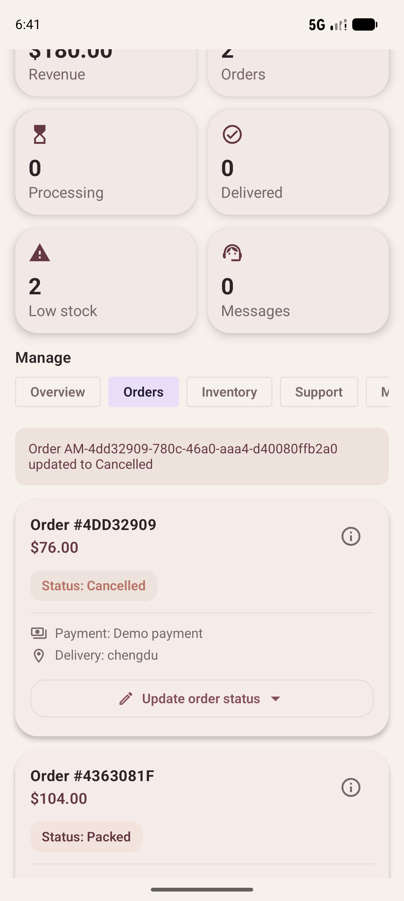
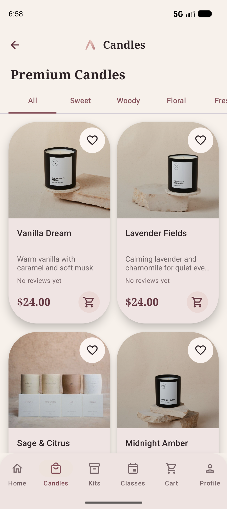
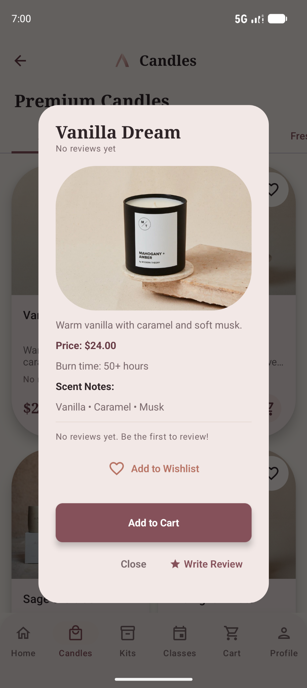
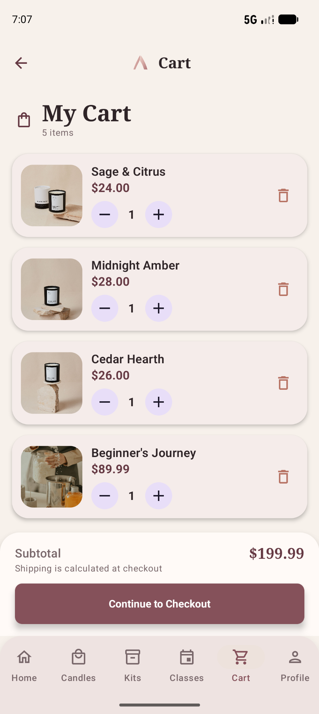
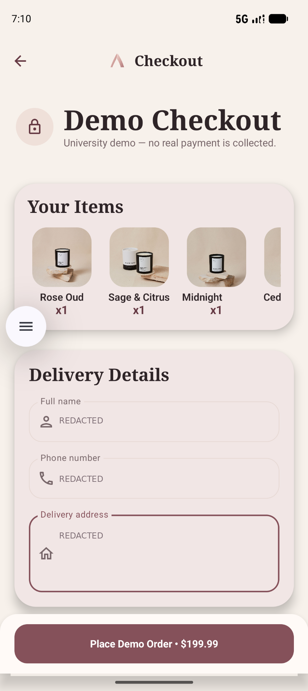
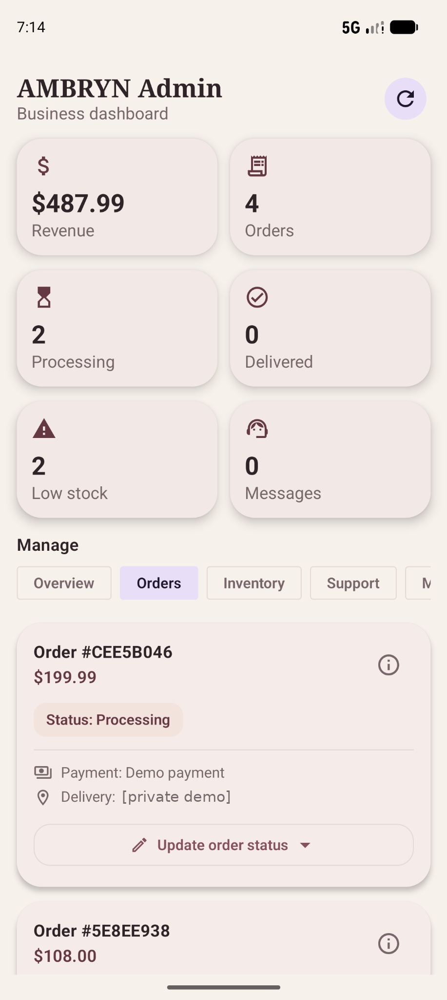

# AMBRYN — Candles & Rituals

**An Android e-commerce experience built with Kotlin, Jetpack Compose and Supabase.**

[](https://github.com/raghd-dev/AMBRYN-Android/actions)


AMBRYN is an educational shopping-app project developed from university coursework and refined for a software engineering portfolio. It demonstrates a customer shopping journey and an administrator workflow, including server-side data access controls and automated build testing.

> **Portfolio demo — not a real store.** Checkout creates demonstration orders; no actual card payments are accepted. The Android application ID retains `com.moonglow.candles` for compatibility with the original university project.

## Explore the app

These are **real emulator captures**, not generated UI mockups. They should only be published after reviewing each image for private customer details and third-party photography rights.

| Home | Candle catalog | Product details |
|:--:|:--:|:--:|
|  |  |  |
| **Cart** | **Demo checkout** | **Admin orders** |
|  |  |  |

[Watch the 28-second **private screenshot walkthrough**](docs/media/AMBRYN_Private_Demo_Walkthrough.mp4) — a slideshow of real emulator captures, not a recording of live interactions. The video uses the existing demo product photography and is **not cleared for public redistribution**.

> The screenshots are real emulator captures. The Checkout and Admin order screenshots have **opaque privacy redactions** covering entered contact/location fields; these are not AI-generated app screens. The current Catalog, Product and Cart emulator captures are included in this private-repository patch. The Home screenshot is kept from your local project and is not overwritten. Verify each filename and review the [screenshot checklist](docs/screenshots/README.md). **Keep the repository private while image licensing and Git history remain unresolved.**

## Features

| Customer experience | Administration |
|---|---|
| Sign-up, sign-in and session restoration | Role-protected admin dashboard |
| Browse and search candles, kits and workshops | Stock display and inventory editing |
| Product details, wishlist and shopping cart | View demonstration orders and update statuses |
| Quantity changes and order-total preview | Compact order references and status selection |
| Demo checkout and order history | Confirmation before cancelling an order |
| Review and support interfaces | Message viewing and demonstration notifications |

Workshop flows and support interfaces are educational features, **not** a production booking or messaging system. Administrator replies to support messages remain disabled pending privacy-focused thread handling.

## Engineering highlights

**Cart crash regression fix.** The app previously crashed when multiple cart records shared the same Jetpack Compose lazy-list key (`p1`). Cart entries are now consolidated by product ID, with quantities merged before rendering and persistence. Regression tests cover duplicate IDs, invalid quantities and empty carts.

**Order management UX.** Admin cards now use short, readable order references while retaining access to the full ID. A single status selector replaces the previous button stack, and cancellation requires confirmation. A small formatting helper is covered by unit tests.

**Backend access control.** Customer data uses Supabase authentication and PostgreSQL Row Level Security (RLS). The project includes RLS verification queries and reports a database-role simulation that rejected a non-admin inventory write. This is **not** a substitute for full customer-JWT API testing or a production security audit.

**Reproducible builds.** The repository includes an Android GitHub Actions workflow that runs unit tests and assembles a debug build using placeholder public configuration rather than production credentials.

## Stack

- **Language/UI:** Kotlin, Jetpack Compose, Material 3, Navigation Compose
- **Android:** Coroutines, DataStore, Android Keystore-backed session storage
- **Network/backend:** OkHttp, Supabase Auth + REST, PostgreSQL with RLS
- **Build/testing:** Gradle Kotlin DSL, JUnit 4, GitHub Actions
- **Build targets:** min SDK 26, compile SDK 35; JDK 21 in tested developer environment

## Build and run

1. Open the project in Android Studio with JDK 21 and the Android SDK 35 platform.
2. Copy `local.properties.example` to `local.properties` at the project root. Supply your **own** Supabase project URL and **publishable** key. Never put a service-role key in an Android application.
3. Configure a compatible database and server-side policies following the project's documented schema. Historical SQL files are reference material; **do not blindly reapply RLS migrations**.
4. On Windows, run:

```bat
cd /d D:\AMBRYN_Release\AMBRYN
set "JAVA_HOME=C:\Program Files\Android\Android Studio\jbr"
set "PATH=%JAVA_HOME%\bin;%PATH%"
gradlew.bat --no-daemon --console=plain testDebugUnitTest assembleDebug
```

5. Run the debug build on an emulator or Android device, sign in with a test account, and use the **demo** checkout flow. No real payment processing is connected.

The local directory above is an example of the developer's setup, not a required installation path. Never commit `local.properties`, database backups, or private account data.

## Verification — October 27, 2026

| Check | Result / evidence |
|---|---|
| Cart and checkout | **PASS — emulator screenshots and developer confirmation:** cart opens, duplicate-key crash resolved, quantities shown, checkout opened and a demo order appeared in Admin. |
| Admin Orders update | **PASS — developer-reported manual verification:** readable short IDs, compact status menu, status updates and cancellation confirmation. |
| Local Android tests and debug build | **PASS — developer terminal:** `testDebugUnitTest assembleDebug`, `BUILD SUCCESSFUL in 1m 5s` for the Admin update. |
| GitHub Actions | **PASS — developer screenshots confirmed green CI on `02ea321` (Cart), `85db419` (Admin), and `76bf2f5` (portfolio screenshots).** Latest observed workflow #7 for `76bf2f5` completed in 1m 54s. This does not certify runtime security or rights. |
| JVM tests | **24 JUnit test cases in the tested source set:** 17 original + 3 cart-regression + 4 Admin-formatting tests. |
| Server authorization | **Partially verified:** RLS and privilege checks and a simulated non-admin stock-write denial; no independent penetration test or confirmed live non-admin JWT denial. |
| Public asset redistribution | **NOT CLEARED:** third-party product photo provenance and historical Git assets must be reviewed before the repository becomes public. |

See [QA evidence](docs/TEST_RESULTS.md) and [public-release requirements](docs/FINAL_RELEASE_GATES.md) for what has—and has not—been verified.

## Project structure

```text
app/src/main/java/com/moonglow/candles/
  core/           # Navigation and app theme
  data/           # Models, repositories and remote services
  domain/         # Reusable business rules
  presentation/   # Customer and Admin Compose screens
app/src/test/     # JVM unit and regression tests
docs/             # Screenshots, QA evidence and release notes
sql/              # Database history and read-only verification scripts
.github/workflows/android-ci.yml
```

## Known limits & publication status

- Checkout is simulated, with no payment provider, transactional stock reservation, or fully authoritative production order calculation.
- Cart/wishlist synchronization has used delete-and-reinsert rather than an atomic server-side transaction; network interruptions can create partial updates.
- Workshop flows are not persistent production bookings; notifications are not private device push; admin support replies are disabled.
- Database RLS tests are not a substitute for independent production-grade security, accessibility or cross-device testing.
- One historical admin-role row without a user ID was observed in the verified database state; no privilege was assigned based solely on a matching email address.
- Original product images may include third-party brands and **are not yet approved for public redistribution**. A disclaimer alone does not grant rights; making the repo public exposes historical committed versions as well.
- The **repository remains private** while third-party image redistribution rights and historical-Git screening remain unresolved. The private portfolio preview and release checklist are available in `docs/PHASE1_PRIVATE_RELEASE_REPORT.md`. No production-readiness claim is made.

Read the [portfolio case study](docs/PORTFOLIO_CASE_STUDY.md) and [release gates](docs/FINAL_RELEASE_GATES.md).

## Project background

AMBRYN is a portfolio evolution of the university project **MoonGlow Candles**, not a claim that the application began as a commercial product. The current app label is AMBRYN, while legacy Android package identifiers are retained to avoid breaking integrations. Third-party licensing, group contributions (if any), and commercial trademark availability should be documented before wider reuse.
