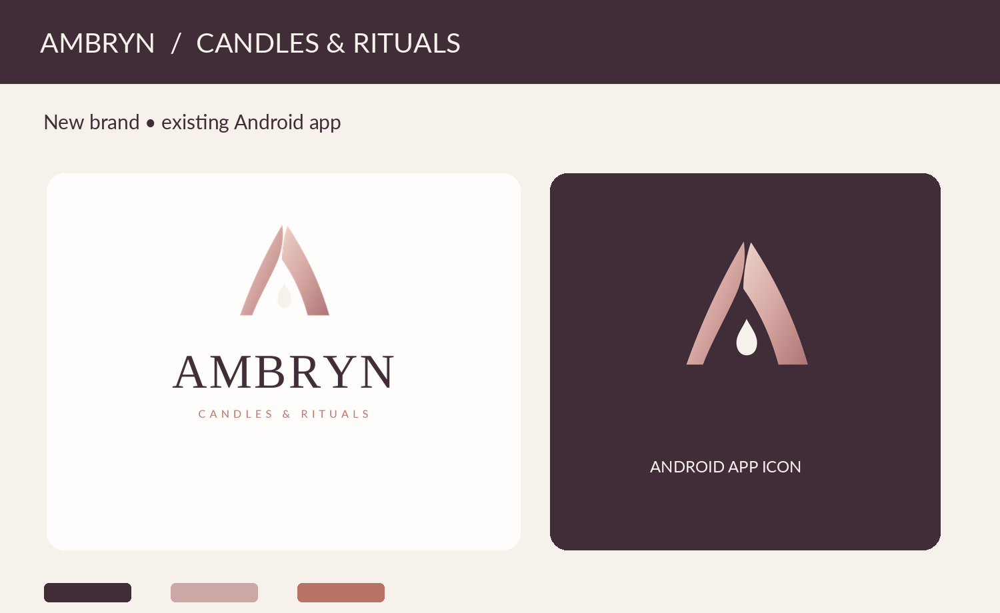
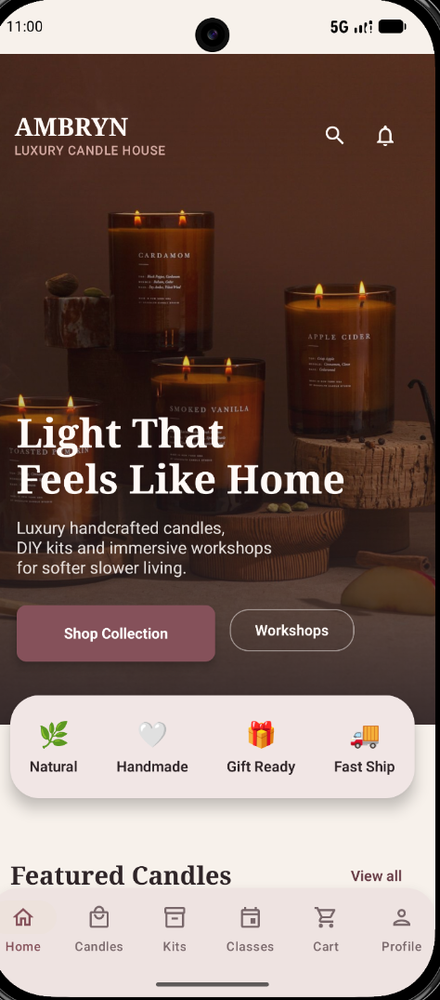

# AMBRYN — Candles & Rituals

A university Android e-commerce application built using **Kotlin**, **Jetpack Compose**, **Material 3**, and **Supabase Auth + REST**. AMBRYN is a portfolio rebrand of a coursework app originally named MoonGlow Candles.



> **Project type:** Educational / portfolio demonstration. Checkout is simulated; this app does **not** process real payments and should not be operated as a commercial store.

## Features

**Customer**: account registration and login, session restoration, catalog browsing, product details and search, cart, wishlist, simulated checkout, order history, reviews, DIY kits, workshops, and support interface.

**Administrator**: role-protected dashboard, stock monitoring and updates, demo order status updates, messages view, and notification creation. **Replies to support messages are intentionally disabled** pending private-thread design.

Some university demo experiences (such as workshops) are not persistent production booking systems.

## Tech stack

- Android / Kotlin / Jetpack Compose / Material 3 / Navigation Compose
- Coroutines, OkHttp, Android Keystore-backed authentication session storage, DataStore
- Supabase Auth and REST API, PostgreSQL Row Level Security (RLS)
- Gradle Kotlin DSL; min SDK 26; compile SDK 35

## Verification status — October 26, 2026

| Check | Status | Evidence / limits |
|---|---|---|
| Local Android build and JVM unit tests | **PASS** | Developer ran `testDebugUnitTest assembleDebug` with Android Studio JDK 21; Gradle exit code `0`, `BUILD SUCCESSFUL in 34s` (`--no-daemon`). |
| Customer and administrator journeys | **PASS (manual)** | Login, cart, wishlist, demo checkout, orders, admin stock and order changes; developer-reported checks. |
| UI/UX regression | **PASS (7/7 reported)** | Home, product details, cart, wishlist, checkout, profile/order history and admin dashboard. |
| Database RLS and permission inspection | **PASS for checks performed** | RLS enabled on all 10 public app tables; selected grants and review-email permissions checked. |
| Stock write-denial simulation | **PASS** | PostgreSQL authenticated-role simulation returned non-admin `false`, `UPDATE 0`, and `ROLLBACK`. Not a live customer-JWT API test. |
| Cart/wishlist ownership | **PASS** | 3 cart rows and 3 wishlist rows: 0 NULL owners and 0 mismatches against Auth user IDs/emails in read-only queries. |
| Public-schema backup | **Readable archive** | `pg_restore --list` returned exit code `0`; a full restore was **not** tested. Auth/Storage not included. |
| GitHub Actions remote CI | **PENDING** | Workflow is configured but must run after first push. |
| Product-image rights and complete screenshot gallery | **PENDING** | Do not make the repository public before clearing assets and removing sensitive content. |

There remains **one historical admin-role row with `user_id IS NULL`**. The inspected `ambryn_is_admin()` function matches the signed-in user's UUID; this unlinked row cannot authorize a user via that function. It was deliberately left unchanged rather than assigning privileges from an email match. Before a production deployment, review authorization using real customer/admin API tokens and independent security testing. See [release gates](docs/FINAL_RELEASE_GATES.md).

## Getting started

1. Open this folder in Android Studio using its bundled **JDK 21** (or a compatible JDK 17) and Android SDK 35. **Do not run Gradle 8.13 with Java 26**, which caused an initialization failure in the developer environment.
2. Copy `local.properties.example` to `local.properties` at the **project root**. Add your **own** Supabase project URL and publishable key; never use service-role or secret keys in an app.
3. The app requires a compatible Supabase database schema, role setup, and the RLS policies documented in `sql/` / `docs/`; it does not automatically create a server database.
4. Sync Gradle and build: `gradlew.bat --no-daemon testDebugUnitTest assembleDebug` (Windows). Start the app on an emulator/device.
5. Use a **test** user account; checkout is a demonstration only. Do not enter real payment details.

The branded app label is `AMBRYN`; the internal Android `applicationId` and Kotlin namespace intentionally remain `com.moonglow.candles` for compatibility. Changing those is a separate migration.

## Testing and continuous integration

The project includes **17 JUnit test cases** in `app/src/test/`, covering demo shipping boundaries, quantity/subtotal calculations, nonempty checkout-form fields, and currency formatting. Checkout UI and stored demo order calculations now share `calculateDemoTotals()`. These tests do **not** simulate payments or replace API-level security testing.

Run on Windows from the project root:

```bat
set "JAVA_HOME=C:\Program Files\Android\Android Studio\jbr"
set "PATH=%JAVA_HOME%\bin;%PATH%"
gradlew.bat --no-daemon --console=plain --no-parallel --max-workers=2 testDebugUnitTest assembleDebug
```

The developer ran this on **October 26, 2026** with **exit code 0** and **`BUILD SUCCESSFUL in 34s`**, after an earlier persistent-daemon connection error. The UI/customer/admin acceptance checks were reported separately; see [`docs/TEST_RESULTS.md`](docs/TEST_RESULTS.md).

**GitHub Actions:** `.github/workflows/android-ci.yml` runs JVM unit tests and a debug build on JDK 21 / Android SDK 35. It uses placeholder public Supabase configuration rather than production credentials. **No remote GitHub Actions result has been verified yet.**

### Real emulator screenshots

Actual developer-supplied emulator captures (the Home image is cropped from the Android Studio emulator pane; no replacement UI was generated):

| Splash | Updated Home |
|:--:|:--:|
|  |  |

More *updated-build* screenshots can be added before a public portfolio launch. Older screenshots showing pre-fix UI, credentials, names or editor windows are intentionally excluded. Images of third-party candle products remain subject to asset-rights clearance.

## Security and limitations

**Published code is a portfolio demonstration, not a production commerce system.**

- API calls use a Supabase **publishable** key and a user JWT; authorization is enforced server-side with RLS. Never ship a `service_role` key.
- Cart and wishlist rows were verified to match their Supabase Auth owners. Administrator role is assigned only through trusted database setup. One unlinked historic admin-role row remains and should not be relinked solely by matching an email address.
- Database authorization was checked by RLS/privilege queries and manual customer separation, **not** by a full independent penetration test.
- Cart and wishlist synchronization still uses delete-and-reinsert, not an atomic transaction; network failures may result in partial synchronization.
- Order totals, promotional logic, stock reservation and checkout are not validated through a production transactional commerce backend. Persisted demo orders contain summary/order fields, not a separate transactional order-item detail table.
- Global in-app notifications are not private push notifications; support replies are disabled pending thread-specific privacy controls.
- `public` schema dumps are **not** full Supabase Auth or Storage backups and should never be committed.
- Before deploying outside coursework, validate licensing for all bundled product images/assets and perform independent security, accessibility and device testing.

## Repository structure

- `app/src/main/java/com/moonglow/candles/core/`: theme and navigation
- `app/src/main/java/com/moonglow/candles/data/`: models, network clients, repositories, and session handling
- `app/src/main/java/com/moonglow/candles/presentation/`: customer and administrator UI
- `docs/`: brand assets, test results, acceptance tests, and release instructions
- `sql/`: migration history and read-only checks (do **not** reapply the historical RLS cutover)

## Origin and contributions

University Android e-commerce coursework, developed and adapted for a software engineering portfolio. Document your personal contributions, team involvement if any, and attribution to third-party assets before public publication.

**Public publication gate:** Before changing from a private repository to public, confirm third-party image rights, exclude personal data, inspect all staged files and Git history, and verify the GitHub Actions build.

**Name note:** AMBRYN is a working portfolio identity; commercial trademark and domain availability have not been cleared.
